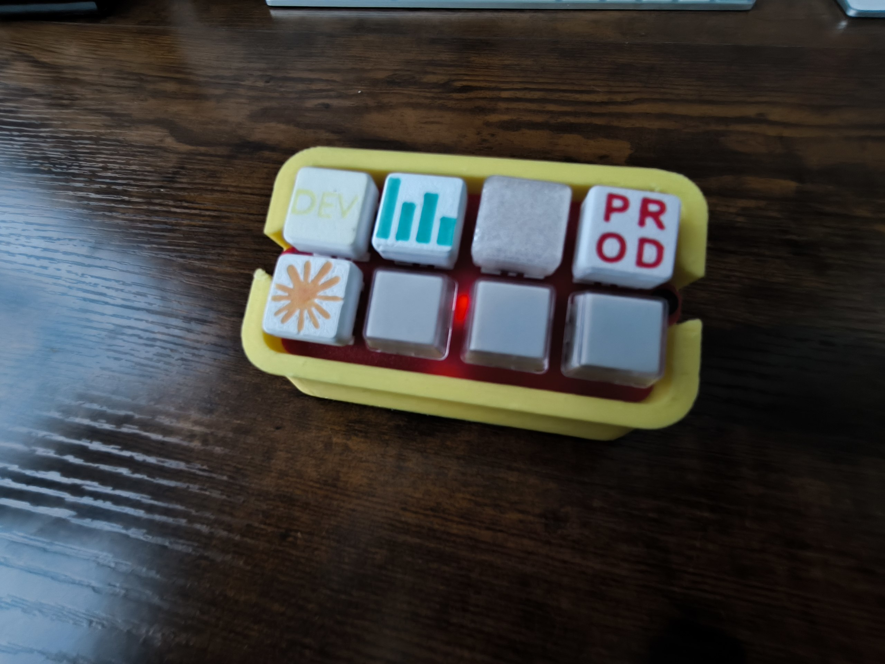

# keydeck

[Русский](#ru) · [中文](#zh) · [English](#en)

<a id="ru"></a>

## Русский

Макроклавиатура на **ESP32-S3**: 8 кнопок, корпус напечатан. По Bluetooth это клавиатура и шлёт **F13–F20**. Что делать по кнопке, решает программа на маке: вставить текст, произнести фразу, запустить команду, перед действием спросить подтверждение. Прошивку при смене фразы перепрошивать не нужно.

В программе язык интерфейса переключается в настройках: **русский, китайский, английский**.

### Состав

| Путь | Что это |
|---|---|
| `firmware/keydeck/` | скетч ESP32-S3 |
| `firmware/keydeck_scan/` | сканер пинов кнопок |
| `firmware/libs/` | библиотека BLE с правками, см. `KEYDECK-PATCH.md` |
| `macos/` | программа для мака |
| `cad/` | колпачки, gcode и шток кнопки питания |
| `docs/` | фото сборки и заметки по BLE |

Корпус в репозитории не лежит.

- Основной: [Stream Cheap, Thingiverse 2822140](https://www.thingiverse.com/thing:2822140)
- Вариант под ESP32-S3: [MakerWorld 1899311](https://makerworld.com/en/models/1899311-esp32-stream-cheap-deck-ble-usb-macro-keyboard)

### Кнопки

В скетче пример **по порядку**: два ряда по четыре, слева направо, сверху вниз. На собранной плате провода сначала припаяны, и только потом кнопки в прошивке подогнаны под те пины, которые реально оказались на проводах. Этот разнобой в пример не входит.

| Кнопка | 1 | 2 | 3 | 4 | 5 | 6 | 7 | 8 |
|---|---|---|---|---|---|---|---|---|
| Место | верх, 1 | верх, 2 | верх, 3 | верх, 4 | низ, 1 | низ, 2 | низ, 3 | низ, 4 |
| GPIO | 1 | 2 | 3 | 4 | 13 | 12 | 11 | 10 |
| Клавиша | F13 | F14 | F15 | F16 | F17 | F18 | F19 | F20 |

Кнопка на GND, второй контакт на GPIO, `INPUT_PULLUP`. **POWER** GPIO5, **LED** GPIO7, **BAT_ADC** GPIO8, RGB на плате GPIO48. На S3 заняты 19/20 (USB), 26–37 (flash) и обычно 43/44 (UART).

### Питание

Клавиатура работает без кабеля: внутри банка **3,7 В, около 500 мА·ч** от электронной сигареты и модуль зарядки **03962A** (TP4056 и защита DW01A). Банка на **B+ / B−**, плата питается с **OUT+ / OUT−**.

- Разъём **USB-C** и кнопка выключения врезаны в стенку. В модели корпуса этих окон нет: отверстия сверлили уже в напечатанной детали. Перед следующей печатью их лучше заложить в модель.
- Кнопка на GPIO5 и GND. Долгое нажатие 1,5 с — сон, короткое — автосон через 2 часа. Будит только эта кнопка.
- До свитча через стенку доходит шток `cad/case/Mini_Push_Switch_Extension_6.stl`, **6 × 6 × 12 мм**, без своей пружины. Печаталась эта длина, PETG. Исходник — [Extension shafts](https://www.printables.com/model/612608-extension-shafts-for-pushbutton-switches), размер `_6`.
- Снизу приклеен кусок резины, чтобы корпус не скользил.
- Светодиод «включено»: GPIO7 через **220 Ом**.

Ток заряда задаёт **R3** на TP4056. С завода **122** (1,2 кОм, 1 А). Для этой банки стоит **752** (7,5 кОм, около 160 мА). Резисторы светодиодов модуля **102** не менялись.

Уровень заряда уходит в Bluetooth раз в 30 с. Делитель 1:1 с B+, два резистора **100 кОм** (код 104), середина на GPIO8:

```
B+ --[100k]--+--[100k]-- GND
             |
           GPIO8
```

### Сборка

```sh
./firmware/build.sh            # собрать
./firmware/build.sh --upload   # прошить
./macos/build.sh --run         # программа на маке
```

Плата ESP32S3 Dev Module, ядро 3.3.2. В Arduino IDE: USB Mode → Hardware CDC and JTAG, USB CDC On Boot → Enabled. В Bluetooth устройство называется **keydeck**.

Колпачки и gcode — в `cad/`. Печать на Ender-3 V3 KE: `cad/print/all-petg/` (всё PETG) или `cad/print/1-pla-2-petg/` (сначала PLA, потом PETG). Наборов «всё PLA» и «сначала PETG, потом PLA» нет.

### Благодарность

Bitcoin: `bc1q8dtk9sar0862ckav0hacmvllwkhy00rvzn6puv`

Тот же адрес в меню программы и внизу окна настроек.




<a id="zh"></a>

## 中文

**ESP32-S3** 八键宏键盘，外壳为 3D 打印。通过蓝牙表现为键盘，发送 **F13–F20**。每个键做什么由 Mac 程序决定：粘贴文本、朗读、运行命令，或在执行前要求确认。更换短语时不用重新烧录固件。

程序设置里可以切换界面语言，顺序为：**俄语、中文、英语**。

### 内容

| 路径 | 内容 |
|---|---|
| `firmware/keydeck/` | ESP32-S3 程序 |
| `firmware/keydeck_scan/` | 按键引脚扫描 |
| `firmware/libs/` | 改过的 BLE 库，见 `KEYDECK-PATCH.md` |
| `macos/` | Mac 程序 |
| `cad/` | 键帽、gcode、电源键延长杆 |
| `docs/` | 组装照片和 BLE 笔记 |

外壳文件不在本仓库。

- 主外壳：[Thingiverse 2822140 Stream Cheap](https://www.thingiverse.com/thing:2822140)
- ESP32-S3 变体：[MakerWorld 1899311](https://makerworld.com/en/models/1899311-esp32-stream-cheap-deck-ble-usb-macro-keyboard)

### 按键

固件示例按**顺序**排列：两行各四个，从左到右、从上到下。实机是先焊好线，再把固件里的按键改成实际焊到的引脚。示例里不用那套不规则接线。

| 按键 | 1 | 2 | 3 | 4 | 5 | 6 | 7 | 8 |
|---|---|---|---|---|---|---|---|---|
| 位置 | 上 1 | 上 2 | 上 3 | 上 4 | 下 1 | 下 2 | 下 3 | 下 4 |
| GPIO | 1 | 2 | 3 | 4 | 13 | 12 | 11 | 10 |
| 键码 | F13 | F14 | F15 | F16 | F17 | F18 | F19 | F20 |

按键一端接 GND，另一端接 GPIO，`INPUT_PULLUP`。**POWER** GPIO5，**LED** GPIO7，**BAT_ADC** GPIO8，板载 RGB 为 GPIO48。S3 上 19/20 为 USB，26–37 为 flash，43/44 通常为 UART。

### 电源

键盘不插线也能用。壳内是一节电子烟上的 **3.7 V、约 500 mAh** 电池，以及充电板 **03962A**（TP4056 和 DW01A 保护）。电池接 **B+ / B−**，主板从 **OUT+ / OUT−** 取电。

- **USB-C** 和电源键是后开在侧壁上的。外壳模型里没有这些孔，是印完再钻的。下次打印前最好先改模型。
- 电源键接 GPIO5 和 GND。长按 1.5 秒休眠，短按切换两小时自动休眠。只有这个键能唤醒。
- 延长杆 `cad/case/Mini_Push_Switch_Extension_6.stl`，**6 × 6 × 12 mm**，自己没有弹簧。只印过这个长度，材料 PETG。来源：[Extension shafts](https://www.printables.com/model/612608-extension-shafts-for-pushbutton-switches) 的 `_6`。
- 底部粘了一块橡胶，避免在桌上滑动。
- 「开机」灯：GPIO7，经 **220 Ω**。

充电电流由 TP4056 的 **R3** 决定。出厂是 **122**（1.2 kΩ，1 A）。这块电池换成了 **752**（7.5 kΩ，约 160 mA）。模块指示灯电阻 **102** 没动。

电量每 30 秒经蓝牙上报。B+ 上 1:1 分压，两只 **100 kΩ**（标记 104），中点接 GPIO8：

```
B+ --[100k]--+--[100k]-- GND
             |
           GPIO8
```

### 编译

```sh
./firmware/build.sh            # 编译
./firmware/build.sh --upload   # 烧录
./macos/build.sh --run         # 运行 Mac 程序
```

开发板选 ESP32S3 Dev Module，核心 3.3.2。Arduino IDE：USB Mode → Hardware CDC and JTAG，USB CDC On Boot → Enabled。蓝牙名称是 **keydeck**。

键帽和 gcode 在 `cad/`。Ender-3 V3 KE：`cad/print/all-petg/`（全部 PETG）或 `cad/print/1-pla-2-petg/`（先 PLA，后 PETG）。没有「全部 PLA」和「先 PETG 后 PLA」。

### 感谢

Bitcoin: `bc1q8dtk9sar0862ckav0hacmvllwkhy00rvzn6puv`

程序菜单和设置窗口底部是同一个地址。


<a id="en"></a>

## English

An **ESP32-S3** macro keypad with 8 keys and a printed case. Over Bluetooth it is a keyboard and sends **F13–F20**. The Mac app decides what each key does: paste text, speak, run a command, or ask for confirmation first. Changing a phrase does not require reflashing.

The app settings switch the interface language: **Russian, Chinese, English**.

### Layout

| Path | What |
|---|---|
| `firmware/keydeck/` | ESP32-S3 sketch |
| `firmware/keydeck_scan/` | pin scanner for the keys |
| `firmware/libs/` | patched BLE library, see `KEYDECK-PATCH.md` |
| `macos/` | Mac app |
| `cad/` | keycaps, gcode, and the power-button shaft |
| `docs/` | build photos and BLE notes |

The case files are not in this repo.

- Main case: [Stream Cheap on Thingiverse 2822140](https://www.thingiverse.com/thing:2822140)
- ESP32-S3 variant: [MakerWorld 1899311](https://makerworld.com/en/models/1899311-esp32-stream-cheap-deck-ble-usb-macro-keyboard)

### Keys

The sketch example is in a **straight order**: two rows of four, left to right, top to bottom. On the built board the wires were soldered first, and the keys in the firmware were then matched to those pins. That irregular wiring is not the example.

| Button | 1 | 2 | 3 | 4 | 5 | 6 | 7 | 8 |
|---|---|---|---|---|---|---|---|---|
| Place | top 1 | top 2 | top 3 | top 4 | bottom 1 | bottom 2 | bottom 3 | bottom 4 |
| GPIO | 1 | 2 | 3 | 4 | 13 | 12 | 11 | 10 |
| Key | F13 | F14 | F15 | F16 | F17 | F18 | F19 | F20 |

One side of each switch is GND, the other is a GPIO, `INPUT_PULLUP`. **POWER** is GPIO5, **LED** is GPIO7, **BAT_ADC** is GPIO8, onboard RGB is GPIO48. On the S3, 19/20 are USB, 26–37 are flash, and 43/44 are usually UART.

### Power

The keypad runs without a cable. Inside is a **3.7 V, about 500 mAh** cell from a vape and charger module **03962A** (TP4056 plus DW01A protection). The cell is on **B+ / B−**. The board is powered from **OUT+ / OUT−**.

- The **USB-C** socket and the power button were cut into the wall. The case model has no holes for them; they were drilled after printing. Add the openings before the next print.
- The button is GPIO5 to GND. Hold 1.5 s to sleep. A short press toggles the 2-hour idle sleep. Only this button wakes the board.
- Shaft `cad/case/Mini_Push_Switch_Extension_6.stl`, **6 × 6 × 12 mm**, no spring of its own. This length was printed in PETG. Source: [Extension shafts](https://www.printables.com/model/612608-extension-shafts-for-pushbutton-switches), size `_6`.
- A piece of rubber is glued underneath so the case does not slide.
- “Power on” LED: GPIO7 through **220 Ω**.

Charge current is set by **R3** on the TP4056. Stock is **122** (1.2 kΩ, 1 A). This cell uses **752** (7.5 kΩ, about 160 mA). The module LED resistors marked **102** were left as they were.

Battery level is sent over Bluetooth every 30 s. A 1:1 divider from B+, two **100 kΩ** resistors (marking 104), midpoint on GPIO8:

```
B+ --[100k]--+--[100k]-- GND
             |
           GPIO8
```

### Build

```sh
./firmware/build.sh            # build
./firmware/build.sh --upload   # flash
./macos/build.sh --run         # run the Mac app
```

Board ESP32S3 Dev Module, core 3.3.2. In the Arduino IDE: USB Mode → Hardware CDC and JTAG, USB CDC On Boot → Enabled. The Bluetooth name is **keydeck**.

Keycaps and gcode are in `cad/`. For an Ender-3 V3 KE use `cad/print/all-petg/` (all PETG) or `cad/print/1-pla-2-petg/` (PLA first, then PETG). There is no “all PLA” set and no “PETG then PLA” set.

### Tips

Bitcoin: `bc1q8dtk9sar0862ckav0hacmvllwkhy00rvzn6puv`

The same address is in the app menu and at the bottom of the settings window.


