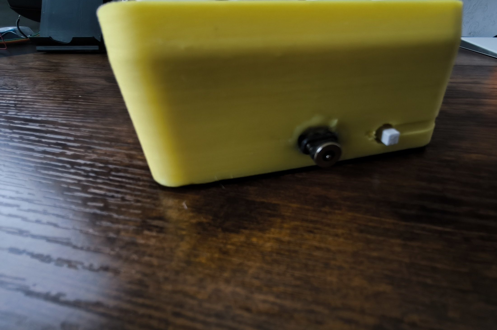
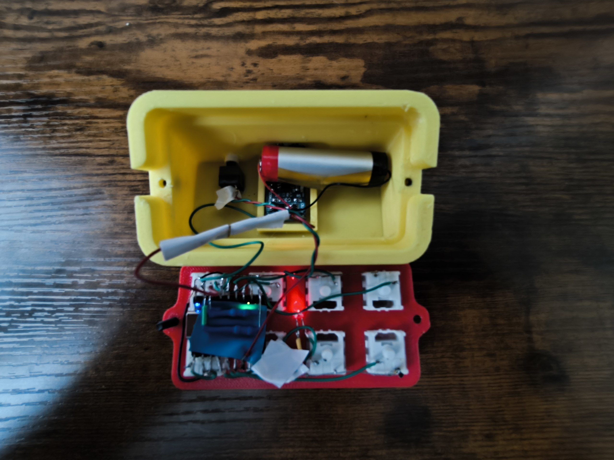

# keydeck

Макро-клавиатура на **ESP32-S3 (EGBO)**, 8 кнопок, корпус напечатан на 3D-принтере.
Устройство представляется маку как **Bluetooth-клавиатура**; что именно делать
по каждой кнопке — решает приложение на маке, а не прошивка.

## Зачем разделение

Скетч шлёт только код клавиши (F13..F20 — свободные функциональные, которых нет
на обычной клавиатуре, поэтому их безопасно переназначать). Вся логика действий
живёт на стороне мака:

- вставить заготовленный текст в поле с курсором;
- произнести фразу;
- запустить команду в шелле;
- перед действием спросить подтверждение той же кнопкой.

Так прошивку не нужно перепрошивать каждый раз, когда меняется действие кнопки —
меняется только конфиг приложения.

## Структура

| Путь | Что это |
|---|---|
| `firmware/keydeck/` | скетч Arduino для ESP32-S3 |
| `firmware/keydeck_scan/` | разовый сканер: находит, к каким GPIO подключены кнопки |
| `firmware/libs/` | вендорнутые библиотеки (см. `KEYDECK-PATCH.md` внутри) |
| `firmware/build.sh` | сборка и прошивка через `arduino-cli` |
| `macos/` | приложение для мака: агент в статус-баре, см. `macos/README.md` |
| `docs/ble-hid-macos-gotchas.md` | грабли BLE-HID на macOS и приёмы отладки |
| `cad/` | корпус STL/3mf и колпачки DEV/PROD (Blender, STL, gcode) — см. `cad/README.md` |

## Железо

- ESP32-S3 (EGBO), определяется маком как `Espressif USB JTAG_serial debug unit`
- 8 кнопок, `INPUT_PULLUP` — кнопка на GND, второй вывод на GPIO
- Распиновка задаётся массивом `KEY_PINS` в скетче

В скетче пример **по порядку**: 2 ряда по 4, слева направо, сверху вниз. На собранной плате провода сначала припаяны, и только потом кнопки в прошивке подогнаны под те пины, которые реально оказались на проводах. Этот разнобой в пример не входит.

| Кнопка | 1 | 2 | 3 | 4 | 5 | 6 | 7 | 8 |
|---|---|---|---|---|---|---|---|---|
| Позиция | верх. левая | верх. 2 | верх. 3 | верх. правая | ниж. левая | ниж. 2 | ниж. 3 | ниж. правая |
| GPIO | 1 | 2 | 3 | 4 | 13 | 12 | 11 | 10 |
| Шлёт | F13 | F14 | F15 | F16 | F17 | F18 | F19 | F20 |

The sketch example is in that straight order. On the built board the wires were soldered first, and the buttons in the firmware were then matched to those pins. That wiring is not the example.

Дополнительно: **POWER** GPIO5, **LED** GPIO7, **BAT_ADC** GPIO8 (делитель с B+),
onboard RGB GPIO48.

Если меняешь пайку — правь `KEY_PINS` и перепроверяй сканером. Учти, что на S3
заняты пины 19/20 (native USB), 26–37 (flash, а на модулях с octal PSRAM ещё и
33–37) и обычно 43/44 (UART0).

### Питание: батарея, зарядка, кнопка, Type-C

Клавиатура работает без кабеля. Внутри корпуса лежат аккумулятор и плата зарядки, выход зарядки соединён с платой ESP32-S3.

- Аккумулятор — элемент **3,7 В, 500 мА·ч** от электронной сигареты.
- Зарядка — модуль **03962A**: TP4056, защита DW01A. Аккумулятор на **B+ / B−**, плата питается с **OUT+ / OUT−**.
- На корпусе отдельно выведен разъём **USB-C** — через него зарядка получает 5 В. Это не штатный разъём платы.
- Кнопка выключения тоже добавлена в корпус: тактовая, на **GPIO5** и GND. Долгое нажатие (1,5 с) уводит плату в сон, короткое переключает автосон. Проснуться можно только этой кнопкой.
- В готовой модели корпуса отверстий под этот разъём и кнопку нет. Их сверлили уже в напечатанной детали. Лучше заранее поправить модель дна и напечатать с окнами под USB-C и кнопку. Исправленного STL корпуса нет.
- До тактовой кнопки через стенку доходит напечатанный шток, без своей пружины: возвращает сам свитч. Файл `cad/case/Mini_Push_Switch_Extension_6.stl`, габарит **6 × 6 × 12 мм**. На принтере эта длина одна, 13 октября 2026, PETG, около 5 минут. Других длин в истории нет. Исходная модель — [Extension shafts for pushbutton switches](https://www.printables.com/model/612608-extension-shafts-for-pushbutton-switches), вариант `_6`.
- Снизу приклеен кусок резины, чтобы корпус не скользил по столу.
- Индикатор «включено»: светодиод на **GPIO7**, анод через **220 Ом** на GPIO, катод на GND.

Резистор тока на зарядке. У TP4056 ток задаёт **R3**. С завода там стоял **122** (1,2 кОм) — это **1 А**, для банки 500 мА·ч много. R3 заменён на **752** (7,5 кОм), ток около **160 мА**. R1, R2, R5, R6 с кодом **102** — резисторы светодиодов модуля, их не меняли.

Уровень заряда в Bluetooth. Раньше скетч всегда слал 100%. Теперь раз в 30 с читает напряжение банки и шлёт процент в Battery Service (`setBatteryLevel`). Делитель **1:1** с **B+** (не с 5 В USB и не с выхода повышайки), два одинаковых резистора **100 кОм** (код **104**):

```
B+ --[100k]--+--[100k]-- GND
             |
           GPIO8
```

Без делителя в Serial будет `battery: no sense`, macOS останется на последнем известном значении.





### Power: battery, charger, button, USB-C

The keypad runs without a cable. A cell and a charger sit in the case; the charger output feeds the ESP32-S3.

- Cell: **3.7 V, 500 mAh**, taken from a vape.
- Charger: module **03962A** (TP4056 plus DW01A protection). Cell on **B+ / B−**, board on **OUT+ / OUT−**.
- A **USB-C** socket on the case wall feeds the charger. It is not the socket on the ESP32 board.
- A power button is added the same way: momentary switch from **GPIO5** to GND. Hold 1.5 s to sleep; a short press toggles idle sleep. Only this button wakes the board.
- The published case has no holes for this socket or button. They were drilled into the part after it was printed. Change the base model first and print it with openings for USB-C and the button. There is no revised case STL.
- A printed shaft reaches the tact switch through the wall. It has no spring of its own; the switch pushes it back. File `cad/case/Mini_Push_Switch_Extension_6.stl`, **6 × 6 × 12 mm**. The printer history has only this length, 13 October 2026, PETG, about 5 minutes. Source model: [Extension shafts for pushbutton switches](https://www.printables.com/model/612608-extension-shafts-for-pushbutton-switches), the `_6` size.
- A piece of rubber is glued underneath so the case does not slide.
- “Power on” LED: **GPIO7**, anode through **220 Ω**.

Charge current. TP4056 sets it with **R3**. The stock part was **122** (1.2 kΩ), which is **1 A** — too much for a 500 mAh cell. R3 is now **752** (7.5 kΩ), about **160 mA**. **R1, R2, R5, R6** marked **102** are the module’s LED resistors and were left alone.

Battery level over Bluetooth. The sketch used to report 100% forever. It now reads the cell every 30 s and sends the percent (`setBatteryLevel`). The divider is **1:1** from **B+** (not from 5 V USB), two **100 kΩ** resistors (marking **104**), midpoint on **GPIO8**. Without it the serial log says `battery: no sense`.

## Прошивка

```sh
./firmware/build.sh            # собрать
./firmware/build.sh --upload   # собрать и прошить
./firmware/build.sh --scan --upload  # прошить сканер пинов
```

Плата **ESP32S3 Dev Module**, core **3.3.2**. Скрипт использует проектный
`.arduino-cli.yaml`: ядро, библиотеки и кэш лежат в `.arduino/` внутри проекта,
`~/Library/Arduino15` не трогается.

Библиотек ставить не нужно. `ESP32 BLE Keyboard` (T-vK) вендорнута в
`firmware/libs/ESP32_BLE_Keyboard` с шестью правками — сборка под core 3.x плюс
баги NimBLE-ветки ядра; подробности и адреса строк в `KEYDECK-PATCH.md` рядом с
ней. `NimBLE-Arduino` **не нужна**: на S3 встроенная библиотека `BLE` ядра уже
работает поверх NimBLE (`nimble_port_init()`), поэтому `USE_NIMBLE` в
`BleKeyboard.h` должен оставаться закомментированным.

Опции USB у S3 уже зашиты в `FQBN` внутри `build.sh`. При сборке через Arduino IDE
их надо выставить руками (S3 придирчив к USB-режиму):

- `USB Mode` → `Hardware CDC and JTAG`
- `USB CDC On Boot` → `Enabled` (иначе `Serial` молчит)

После `bleKeyboard.begin()` устройство появится как **keydeck** в списке
Bluetooth-устройств мака.

## Основа

Скетч вырос из референса DIY Stream Deck mini macro keyboard
(<https://www.partsnotincluded.com/diy-stream-deck-mini-macro-keyboard/>),
который сам является переработкой библиотеки ESP32-BLE-Keyboard.

## Состояние

**Прошивка работает полностью, проверено на живой плате (ESP32-S3 + macOS):**

- все 8 кнопок доходят до мака как **F13..F20** (подтверждено перехватом событий
  на стороне macOS: `kc=105 F13 … kc=90 F20`);
- BLE-периферия поднимается, macOS спаривает «Just Works», создаёт HID-клавиатуру
  (`hidutil list` → `AppleUserHIDEventDriver`, наш VID `0x303A`);
- плата стабильна при подключении (без циклов перезагрузки).

Путь к этому состоянию был неочевидным — по дороге нашлось несколько багов ядра
esp32 3.x под NimBLE и дефолтов библиотеки. Все описаны в
`firmware/libs/ESP32_BLE_Keyboard/KEYDECK-PATCH.md` (патчи 1–6 + VID/PID). Коротко:
краш при подключении (нулевой колбэк дескриптора), `Read Not Permitted` на Report
Reference (кодировка прав Bluedroid vs NimBLE), и потолок кодов клавиш `0x65`,
из-за которого F13..F20 не доходили.

Приложение на маке тоже работает: перехватывает F13..F20 глобально и выполняет
привязанное к кнопке действие — вставить заготовленный текст, напечатать его или
выполнить команду. Привязки лежат в JSON и перечитываются без перезапуска.
Сборка, выдача разрешения Accessibility и формат конфига — в `macos/README.md`.

### Повторное спаривание после смены прошивки

macOS кэширует Report Map по устройству. Если менял дескриптор/VID — чтобы мак
перечитал: стереть ключи на плате и забыть устройство на маке.

```sh
# стереть ключи спаривания (NVS) на плате
.arduino/.../esptool --chip esp32s3 -p <PORT> erase-region 0x9000 0x5000
# на маке: Системные настройки → Bluetooth → keydeck → «Забыть».
# если мак упорно держит старый дескриптор — сбросить кэш демона:
sudo pkill bluetoothd
```

## Отладка BLE

Полезное при разборе проблем с BLE-HID на macOS:

```sh
# HID-устройство keydeck (VID 0x303A → в выводе байты переставлены: 3a30)
hidutil list | grep -i 3a30

# какой Report Map реально применил мак (нужен "Max"=115 после патча 6;
# "Max"=101 = держит старый кэш, надо перепарить)
ioreg -l -w0 -r -c IOHIDDevice | grep -i keydeck | grep -o '"UsagePage"=7,"Max"=[0-9]*' | sort -u

# что macOS думает о спаривании / ошибках GATT
log show --last 5m --predicate 'process == "bluetoothd"' --style compact \
  | grep -iE "Encryption|Pairing|Read Not Permitted|HOGP|error response"

# состояние устройства
system_profiler SPBluetoothDataType | grep -A 7 -i keydeck
```

Два тупика, в которые не стоит упираться второй раз:

- **`CoreBluetooth` из CLI не видит HID-сервис.** macOS скрывает сервис `0x1812`
  от приложений (даже спаренных) — `discoverServices` возвращает только Device
  Info и Battery. Проверять нажатия надо перехватом событий (`CGEventTap`), а не
  чтением GATT. Самому `CGEventTap` нужен Accessibility для процесса-слушателя —
  это же разрешение понадобится будущему приложению.
- **`blueutil --pair` не спаривает BLE-HID** (ходит по classic → `Page Timeout`),
  а `--unpair` не всегда удаляет запись. Спаривание — только из UI Bluetooth;
  надёжное удаление — «Забыть устройство» в UI или `sudo pkill bluetoothd`.

## Благодарность

Bitcoin: `bc1q8dtk9sar0862ckav0hacmvllwkhy00rvzn6puv`

Тот же адрес в меню приложения («Благодарность: скопировать адрес») и внизу окна настроек.

## Tips

Bitcoin: `bc1q8dtk9sar0862ckav0hacmvllwkhy00rvzn6puv`

The Mac app shows the same address in the status menu and at the bottom of the settings window.
